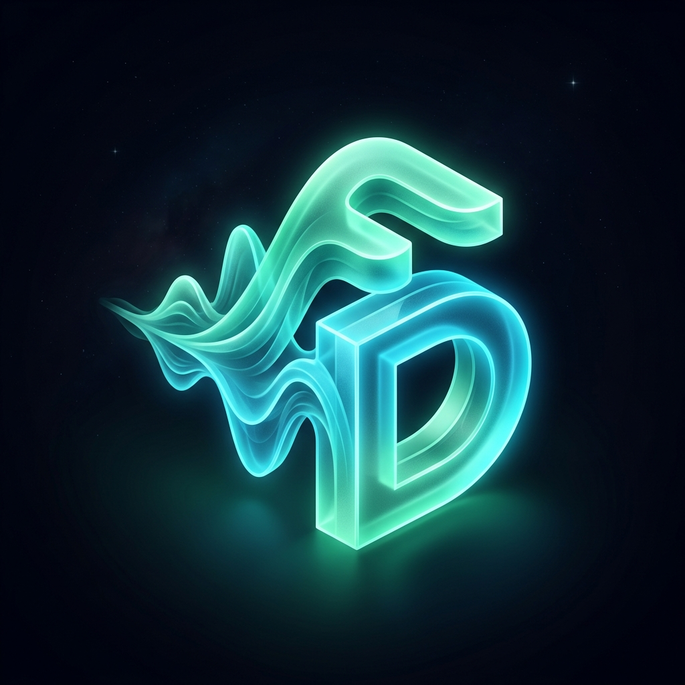

<div align="center">

  

  # FlowDesk AI • Real-Time Voice Sales Specialist

  **Enterprise conversational AI engine engineered for natural, low-latency B2B sales discovery, multilingual customer qualification, and automated post-call intelligence auditing.**

  [](https://www.typescriptlang.org/)
  [](https://react.dev/)
  [](https://fastapi.tiangolo.com/)
  [](https://www.python.org/)
  [](https://vitejs.dev/)
  [](https://supabase.com/)
  [](LICENSE)

  [⚡ 1-Click Startup](#-quickstart--local-setup) • [🎯 Target Users](#-target-users--audience) • [💡 Problems Solved](#-the-problem-we-identified--how-we-solved-it) • [🛠️ Tech Stack](#-technology-stack) • [📊 6 Sales Statuses](#-scripted-test-scenarios--6-sales-statuses)

</div>

---

## 📌 Executive Summary

**FlowDesk AI** is an enterprise-grade voice sales assistant developed for the **Sankar Group AI Voice Sales Bot Assignment**. It conducts human-like inbound and outbound sales conversations representing **FlowDesk** (an AI customer support helpdesk software). 

Unlike standard text chatbots wrapped with generic speech APIs, FlowDesk AI operates on an **asynchronous full-duplex WebSocket loop** featuring **sentence-chunked neural TTS**, **instant client-side barge-in interruption**, **synchronized dual-channel audio recording**, and **deterministic post-call sales rubric guards**.

---

## 🎯 Target Users & Audience

FlowDesk AI is purpose-built for commercial teams that require high-throughput, compliant sales qualification without sacrificing customer experience:

| User Persona | Key Pain Points | How FlowDesk AI Delivers Value |
|---|---|---|
| **High-Growth SMB Founders** | Cannot afford 24/7 SDR teams; inbound leads go cold within 15 minutes. | Instant qualification calls, 24/7 lead capture, and immediate trial booking. |
| **Sales & RevOps Leadership** | Reps log incomplete or inaccurate CRM notes; post-call qualification is subjective. | Deterministic extraction of customer requirements, logged objections, and audit-backed sales outcomes. |
| **Customer Support Directors** | Overloaded with repetitive tier-1 questions (pricing, Shopify integration, SLAs). | AI explains pricing, resolves integration objections, and schedules demos for qualified leads. |
| **Multilingual Indian & Global Buyers** | Language friction with English-only bots leading to drop-offs. | Seamless toggling between natural English (`EmmaNeural`) and conversational Hindi (`SwaraNeural`). |

---

## 💡 The Problem We Identified & How We Solved It

| # | Industry Problem Identified | The Root Cause | FlowDesk AI Architectural Solution |
|:---:|---|---|---|
| **1** | **Robotic Latency & Awkward Pauses** | Standard voice bots wait for the entire LLM completion before initiating text-to-speech. | **Sentence-Chunked Streaming Pipeline:** Audio synthesis starts on the very first punctuation delimiter (`. ? ! \n`), delivering TTFT under **1.2s**. |
| **2** | **AI Voice Collisions (No Interruption)** | The bot talks over the user; customer cannot correct or interject without waiting. | **Instant Full-Duplex Barge-In:** As soon as customer speech is detected, the server cancels active asyncio audio tasks, and the Web Audio context flushes its client playback queue instantaneously. |
| **3** | **Desynchronized Call Recordings** | Recording two separate audio streams creates drift, phase cancellation, or high server mixing costs. | **Client-Side Dual-Stream AudioNode Mixing:** Merges the user's microphone `MediaStreamSource` and the bot's Web Audio `AudioNode` into a single `MediaStreamDestination`, producing a clean, aligned WebM Opus master recording. |
| **4** | **Hallucinated CRM Sales Outcomes** | LLMs hallucinate "Converted" or "Demo Booked" without concrete transcript proof. | **Deterministic Code Rubric Guards:** Strict Python validation guards verify that high-intent statuses (`converted`, `demo_requested`) contain verbatim transcript quotes. Inactive calls (<2 customer turns) auto-short-circuit to `no_response`. |
| **5** | **Language & Accent Exclusivity** | Most voice agents perform poorly on non-English syntax or Indian regional accents. | **Parameterized Dual-Locale Engine:** Built-in support for English (`en-US-EmmaNeural`) and Hindi (`hi-IN-SwaraNeural`) with native discovery prompts. |
| **6** | **Generic "AI Assistant" Aesthetic** | Monotonous, template UIs that fail to inspire buyer trust or show visual audio telemetry. | **Obsidian Aurora Design System:** Deep-space canvas, glowing interactive 3D Acoustic Halo canvas visualizer, live audio frequency spectrum, and typography hierarchy. |

---

## 🛠️ Technology Stack

```
AI-CHATBOT Architecture Stack
┌────────────────────────────────────────────────────────────────────────┐
│ FRONTEND LAYER (Single Page Application)                                │
│ React 19 • Vite 6 • TypeScript 5.9 • Tailwind CSS 3.4 • Lucide SVG    │
│ Web Audio API (AudioContext, AnalyserNode, MediaStreamDestination)     │
│ HTML5 Canvas 3D Acoustic Halo • Native Web Speech API / Audio Queue    │
└───────────────────────────────────┬────────────────────────────────────┘
                                    │ Full-Duplex WebSocket & REST API
┌───────────────────────────────────▼────────────────────────────────────┐
│ BACKEND APPLICATION LAYER (Python 3.10+)                               │
│ FastAPI (Uvicorn ASGI) • WebSockets • Pydantic v2 Settings             │
│ State Machine (Idle -> Connecting -> Listening -> Thinking -> Speaking)│
│ Sentence Chunker (<1.2s Latency) • Asyncio Task Cancellation           │
└──────────────────┬──────────────────────────────────┬──────────────────┘
                   │                                  │
┌──────────────────▼─────────────────┐ ┌──────────────▼──────────────────┐
│ AI & VOICE ENGINE                   │ │ DATA & PERSISTENCE               │
│ • LLM: Groq (Llama-3.3-70b-versatile)│ │ • Cloud Storage: Supabase S3 API │
│   Fallback: Gemini 2.5 / OpenAI     │ │ • Cloud DB: Supabase PostgreSQL  │
│ • TTS: Microsoft Edge-TTS (Neural) │ │ • Local Fallback: SQLite3 & Disk │
│   EN: en-US-EmmaNeural             │ │ • Formats: WebM Opus (Dual-Mix) │
│   HI: hi-IN-SwaraNeural            │ │ • Repositories: DDL-Safe CRUD    │
└────────────────────────────────────┘ └──────────────────────────────────┘
```

---

## ⚡ Quickstart & Local Setup

### 🚀 One-Click Startup (Recommended for Windows)

Double-click **`start.bat`** in the project root, or execute via PowerShell:

```powershell
# PowerShell (1-Click):
.\start.ps1

# Or Command Prompt:
start.bat
```

> **What this does:**
> 1. Validates your Python virtual environment (`backend\venv`).
> 2. Starts the **FastAPI Backend** on `http://127.0.0.1:8000`.
> 3. Starts the **Vite Frontend** on `http://localhost:5173`.
> 4. Automatically launches your default web browser to the application.

---

### Manual Setup

#### 1. Backend Setup
```bash
# 1. Create and activate virtual environment
python -m venv backend/venv

# Windows:
backend\venv\Scripts\activate
# Linux/macOS:
source backend/venv/bin/activate

# 2. Install dependencies
pip install -r backend/requirements.txt

# 3. Configure backend environment in backend/.env
# (Supports Groq, OpenAI, Gemini, or Mock LLM fallback)

# 4. Run backend server
python -m uvicorn backend.app.main:app --port 8000 --reload
```

#### 2. Frontend Setup
```bash
cd frontend
npm install
npm run dev
```
Open **`http://localhost:5173`** in Google Chrome or Microsoft Edge.

---

## 📱 Application Flow & View Architecture

The application is structured into **5 integrated views**:

| # | Screen / View | Primary Functions |
|:---:|---|---|
| **1** | **Live Terminal (Standby)** | • 3D Acoustic Sphere canvas visualizer & live frequency equalizer.<br>• Pre-call interactive scenario cards (Conversion, Demo, Follow-up, Hindi).<br>• Language switch (`English` / `हिन्दी`) and product parameterization. |
| **2** | **Consent & Authorization Modal** | • Mandatory GDPR / California recording compliance gate.<br>• Explicit checkbox consent required before audio streams open. |
| **3** | **Live Active Call Interface** | • Full-duplex voice loop with animated voice waveform.<br>• Live sentence-chunked transcript stream with user & agent speech bubbles.<br>• Real-time call controls: Mute, instant Barge-in interrupt, and Call Timer.<br>• Scripted test bench for instantaneous rubric status testing. |
| **4** | **Post-Call Intelligence Dossier** | • Automated post-call evaluation generated when call ends.<br>• Extracted customer requirements, logged objections, and concrete next steps.<br>• Scrubbable dual-voice audio player with speed controls (1x, 1.25x, 1.5x, 2x). |
| **5** | **Call Archives & Playback** | • Full historical audit log of all recorded calls stored in Supabase / SQLite.<br>• Individual call review modal with message-level timestamps and deletion tools. |

---

## 📊 Scripted Test Scenarios & 6 Sales Statuses

FlowDesk AI incorporates a dedicated **Scripted Test Bench** row for deterministic verification across all 6 rubric categories:

| Sales Status | Trigger Preset / Spoken Utterance | Guaranteed Outcome |
|---|---|---|
| **`converted`** | *"Okay, sign me up for the Pro plan today."* | • Status badge: `Converted (Signed Up)`<br>• Code guard: Verifies explicit plan sign-up quote in transcript. |
| **`demo_requested`** | *"Can I see a live demo on Friday with our team?"* | • Status badge: `Demo Requested`<br>• Action item: Calendar invitation flagged in next steps. |
| **`follow_up_required`** | *"Send me details and call me next week, I need to ask my manager."* | • Status badge: `Follow-up Required`<br>• Logs stakeholder approval requirement. |
| **`interested`** | *"How does FlowDesk handle tier-1 tickets and Shopify?"* | • Status badge: `Interested (Exploratory)`<br>• Answers product capabilities without false commitment. |
| **`not_interested`** | *"We are happy with our current tool, not interested."* | • Status badge: `Not Interested`<br>• Logs competitor satisfaction gracefully. |
| **`no_response`** | Click *Start Call*, remain silent for 5s, click *End Call*. | • Short-circuits immediately without invoking unnecessary LLM analysis. |

---

## 🔒 Security, Compliance & Data Privacy

- **Strict Secret Hygiene:** `.gitignore` blocks all `.env`, credentials, local recordings, and SQLite database artifacts from git history.
- **Pre-Call Audio Consent:** Audio capture cannot commence without explicit affirmative user consent.
- **Supabase Cloud Integration:** Dual-sync architecture uploads recordings directly to authenticated Supabase Storage buckets while syncing call records to Supabase PostgreSQL with local disk fallback.

---

## 📁 Repository Directory Structure

```
AI-CHATBOT/
├── start.bat                     # ⚡ 1-Click Windows Batch Launcher
├── start.ps1                     # ⚡ 1-Click Windows PowerShell Launcher
├── backend/
│   ├── app/
│   │   ├── config.py             # App settings, environment vars, Supabase keys
│   │   ├── db.py                 # SQLite database connection & schema initialization
│   │   ├── main.py               # FastAPI application, REST & WebSocket routes
│   │   ├── schemas.py            # Pydantic v2 models & enums
│   │   ├── prompts/
│   │   │   ├── sales_system.md   # Alex SDR prompt & FlowDesk knowledge base
│   │   │   └── analysis.md       # Post-call evaluation & rubric instructions
│   │   ├── providers/
│   │   │   ├── base.py           # Abstract Base Classes for LLM and TTS
│   │   │   ├── llm_provider.py   # Groq / OpenAI / Gemini unified router
│   │   │   └── tts_provider.py   # Edge-TTS streaming neural voice synthesis
│   │   ├── services/
│   │   │   ├── analysis.py       # Deterministic rubric guards & LLM auditor
│   │   │   ├── calls_repo.py     # SQLite + Supabase dual-sync repository
│   │   │   └── storage.py        # Cloud Supabase Storage & local audio backup
│   │   └── ws/
│   │       └── call_session.py   # Real-time WebSocket session state machine
│   ├── schema.sql                # Supabase PostgreSQL DDL table definitions
│   ├── tests/
│   │   ├── test_analysis_guards.py # Unit tests for deterministic rubric guards
│   │   └── test_api.py           # Unit tests for REST endpoints
│   └── requirements.txt          # Python dependencies
├── frontend/
│   ├── public/
│   │   └── logo.png              # 3D Glass Isometric "FD" Monogram Logo
│   ├── src/
│   │   ├── audio/
│   │   │   ├── playback-queue.ts # Web Audio queue & instant barge-in flush
│   │   │   └── recorder.ts       # Synchronized dual-stream mic+bot recorder
│   │   ├── components/
│   │   │   ├── AcousticHalo.tsx  # Dynamic HTML5 canvas frequency visualizer
│   │   │   ├── AudioPlayer.tsx   # Custom scrubbable audio player with speed controls
│   │   │   ├── CallView.tsx      # Main terminal workspace & scripted test bench
│   │   │   ├── ConsentModal.tsx  # Pre-call compliance authorization modal
│   │   │   ├── DetailModal.tsx   # Detailed call audit & transcript review modal
│   │   │   ├── HistoryView.tsx   # Historical call archives table
│   │   │   ├── LiveTranscript.tsx# Streaming dialogue bubbles & interim speech
│   │   │   ├── StatusBadge.tsx   # Live connection state chip & timer
│   │   │   └── SummaryCard.tsx   # Post-call intelligence dossier card
│   │   ├── hooks/
│   │   │   └── useCallSocket.ts  # Web Audio, STT & WebSocket management hook
│   │   ├── lib/
│   │   │   ├── api.ts            # Typed REST API client
│   │   │   └── status.tsx        # Sales status colors, labels & SVG icons
│   │   ├── types.ts              # TypeScript interface definitions
│   │   ├── App.tsx               # Main layout, navbar & brand header
│   │   └── index.css             # Obsidian Aurora design tokens & animations
│   ├── index.html
│   └── vite.config.ts
├── products/
│   └── flowdesk.json             # FlowDesk product knowledge specification
├── plan.md                       # Comprehensive 48-Hour Implementation Plan
└── README.md                     # Executive Documentation
```

---

<div align="center">
  <sub>Built with precision for the <strong>Sankar Group AI Voice Sales Bot Assignment</strong>.</sub>
</div>
